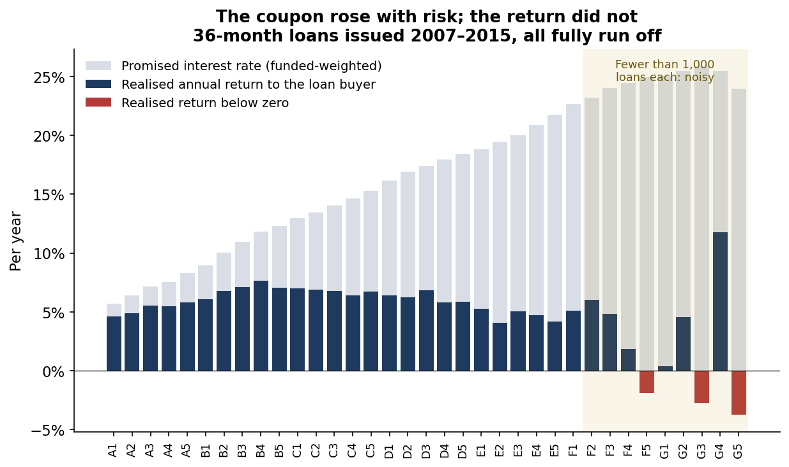
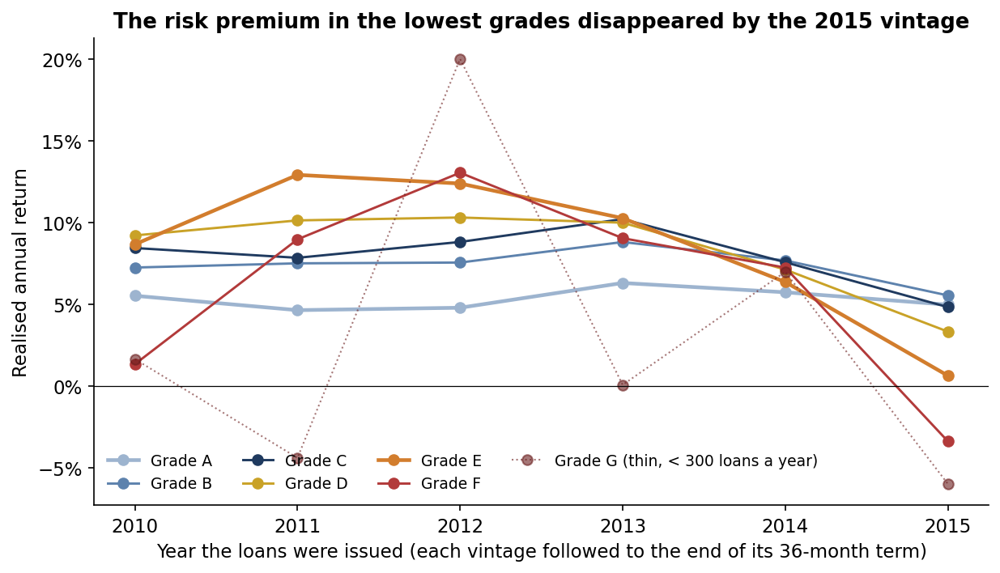
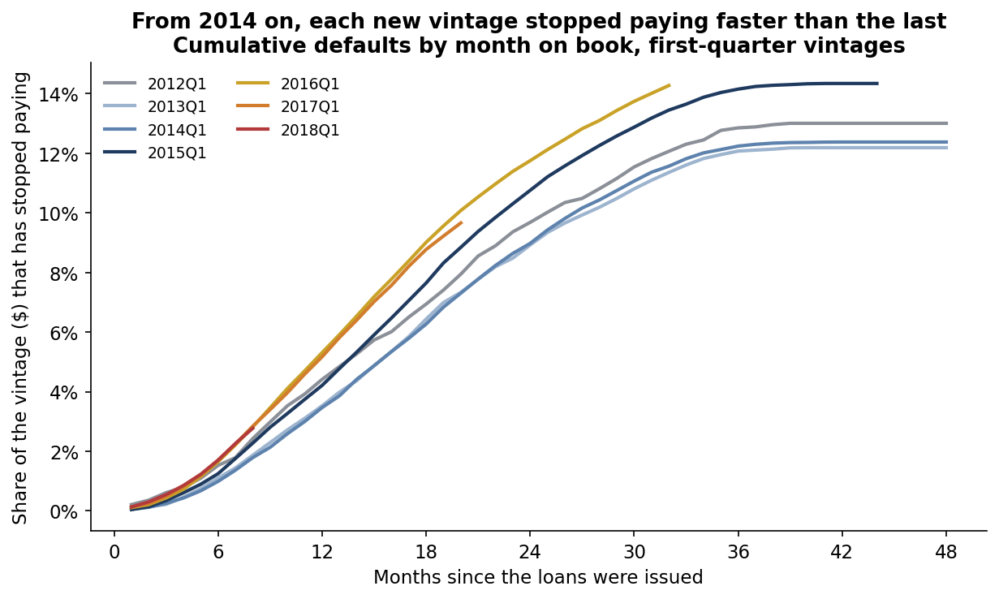
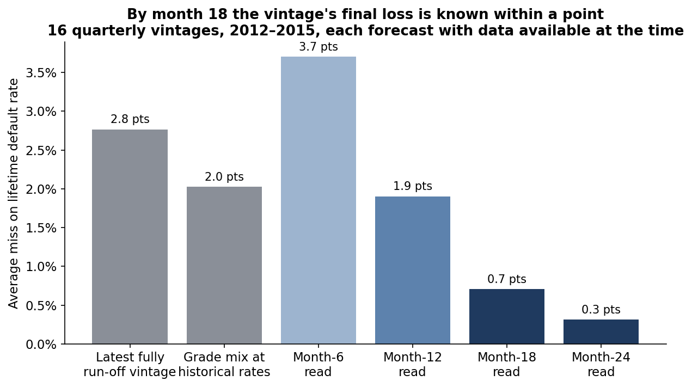
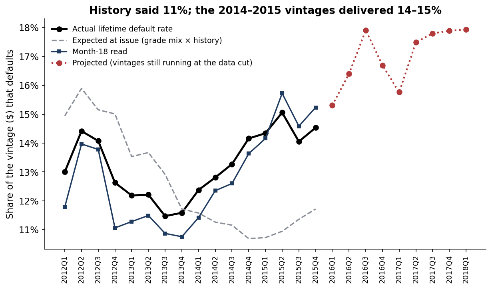
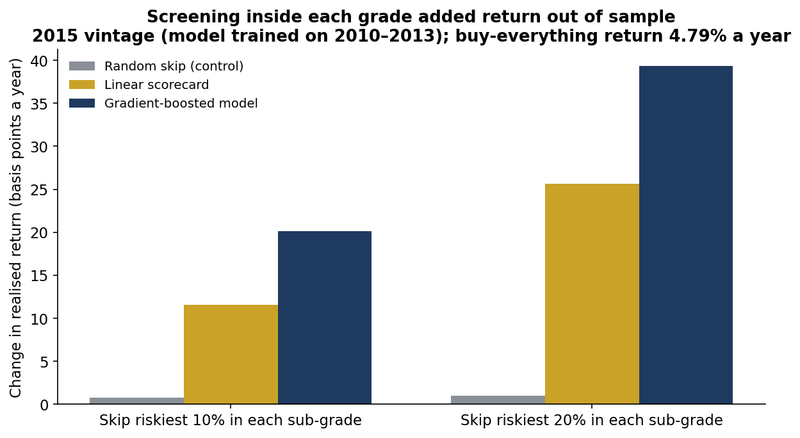
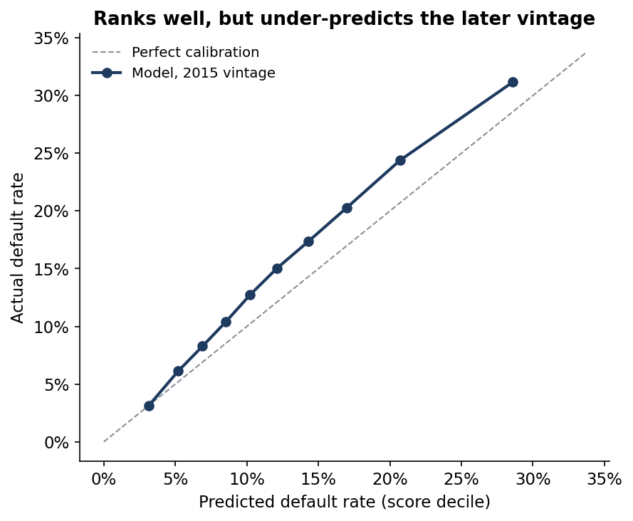

# Did the rate pay for the risk? What 619,000 consumer loans returned against their coupons, 2007–2015

**Question.** A buyer of consumer instalment loans (a bank, a credit fund or a forward-flow partner) is paid through the coupon. The coupon rises with the platform's risk grade. Did the higher coupon actually cover the higher losses? How early can a buyer tell that a new vintage is going worse than priced? And does screening loans inside each grade add return out of sample?

**Answer, on real data.** The data are 618,731 LendingClub 36-month loans ($7.73bn) issued from June 2007 to December 2015. Every one of them had run to the end of its term by the March 2019 data cut.

- **The coupon rose with risk; the return did not.** Promised rates rose from 7.2% (grade A) to 25.3% (grade G). The realised annual return to the buyer, after a 1% servicing fee, peaked at grade B (7.0%) and fell to 4.8% for E, 4.1% for F and 2.4% for G. Grades E–G gave up 15 to 23 points of coupon to credit losses.
- **The premium disappeared over time.** In the 2010–2013 vintages, grade D returned 10.1% a year and E 11.0%. In 2014–2015 they returned 4.8% and 2.9%. Loans issued in 2015 returned 3.4% (D), 0.7% (E) and −3.4% (F), below a 3-year Treasury for E and F.
- **History under-priced the later vintages.** Price each 2014Q4–2015Q4 vintage at its sub-grade mix, using the lifetime default rates of fully run-off vintages. That gives 11.2% of dollars defaulting. The actual figure was 14.4%. At a 52% loss severity, that is about $17M of extra net loss per $1bn bought.
- **The early read works by month 18.** Across 16 quarterly vintages (2012–2015), each forecast used only data available at the time. The average miss on the lifetime default rate was:
  - 2.0 points for the pricing-time expectation and 2.8 points for "same as the last vintage";
  - 1.9 points from a month-12 read, 0.7 points at month 18 and 0.3 points at month 24.
  - Month 6 is too early (3.7 points).
- **Screening inside each grade adds return, but cannot fix price.** A gradient-boosted model was trained on 2010–2013 applications, tuned on 2014 and tested on 2015. Within each sub-grade it ranked defaults better than chance: within-sub-grade AUC was 0.572 (0.564 for a linear scorecard).
  - Skipping the riskiest 20% in every sub-grade raised the 2015 pool return from 4.79% to 5.19% a year: +39 basis points, with a bootstrap 90% band of 36–42. A random skip added 1 basis point.
  - Even after screening, the 2015 E–G loans still returned between 1.0% and −4.6%.
- **Stability checks said nothing changed.** The population stability index of the model score was 0.006, well inside the usual 0.10 alert. Yet the model under-predicted the 2015 default rate by 2.2 points (12.7% predicted, 14.9% actual). The borrowers looked the same; their outcomes did not.

Full write-up: https://www.guptagaurav.info/articles/did-the-rate-pay-for-the-risk

## Results

| Grade (36-month, issued 2007–2015) | Loans | Promised rate | Dollars that defaulted | Net loss on funded $ | Realised return a year | Over 3-year Treasury |
|---|---|---|---|---|---|---|
| A | 142,925 | 7.2% | 5.2% | 2.4% | 5.3% | +4.5 pts |
| B | 211,692 | 10.8% | 11.0% | 5.3% | 7.0% | +6.1 pts |
| C | 161,843 | 13.9% | 17.9% | 9.3% | 6.8% | +5.9 pts |
| D | 76,074 | 17.2% | 24.0% | 13.4% | 6.3% | +5.4 pts |
| E | 21,410 | 19.8% | 29.8% | 17.5% | 4.8% | +3.9 pts |
| F | 4,265 | 23.5% | 35.5% | 21.9% | 4.1% | +3.2 pts |
| G | 522 | 25.3% | 38.4% | 24.7% | 2.4% | +1.5 pts |
| All | 618,731 | 11.8% | 13.5% | 7.0% | 6.3% | +5.5 pts |

| Realised return a year, by vintage | A | B | C | D | E | F |
|---|---|---|---|---|---|---|
| Issued 2010–2013 | 5.7% | 8.4% | 9.7% | 10.1% | 11.0% | 9.0% |
| Issued 2014–2015 | 5.2% | 6.4% | 5.9% | 4.8% | 2.9% | 2.6% |
| Issued 2015 only | 5.0% | 5.6% | 4.9% | 3.4% | 0.7% | −3.4% |

| Forecast of a vintage's lifetime default rate (16 vintages, 2012Q1–2015Q4) | Average miss |
|---|---|
| Latest fully run-off vintage | 2.8 pts |
| Sub-grade mix × seasoned history (what pricing knows at issue) | 2.0 pts |
| Month-6 read × development factor | 3.7 pts |
| Month-12 read | 1.9 pts |
| Month-18 read | 0.7 pts |
| Month-24 read | 0.3 pts |

| Out-of-time screen (test: 283,173 loans issued in 2015) | AUC | AUC within sub-grade | Brier | Pool return, skip riskiest 20% per sub-grade |
|---|---|---|---|---|
| Sub-grade only (the platform's price) | 0.678 | 0.500 | 0.1218 | 4.79% (buy everything) |
| Linear scorecard | 0.678 | 0.564 | 0.1214 | 5.05% |
| Gradient-boosted model | 0.685 | 0.572 | 0.1205 | 5.19% |
| Random skip (control) | n/a | n/a | n/a | 4.80% |

The vintages still running at the data cut (2016Q1–2018Q1) project to 15–18% lifetime default, against average coupons of 11–13%.









## Method

- **Sample.** 36-month loans that met the platform's credit policy. A loan counts as defaulted if its final status is Charged Off, Default or 31–120 days late. "Complete" means issued by December 2015, so the term ended before the March 2019 data cut.
- **Realised return.** Each pool's cash flows run month by month. The purchase price is the funded amount. Borrower payments, less a 1% servicing fee, are spread evenly from the first month to the month of the last payment. Recoveries, net of collection fees, arrive six months later. The annualised internal rate of return of the pooled flows is the realised return. Robustness:
  - Recoveries after 3 or 12 months move grade returns by at most 0.06 points.
  - Removing the servicing fee raises every grade by about 1 point. The ranking does not change.
- **Vintage curves.** Each quarterly vintage is tracked as the share of its funded dollars that has stopped paying, by month on book. The month payments stopped is the month after the last payment. A month on book counts only once every loan in the vintage is at least 4 months past it, because a stopped loan shows as 31+ days late only after about 4 months.
- **Early read.** At month k, the forecast is the cumulative default at k times a development factor. The factor is lifetime default divided by cumulative default at k, dollar-weighted over vintages that had fully run off by that date. Two baselines use only data known at issue:
  - (a) the latest fully run-off vintage;
  - (b) the vintage's sub-grade mix priced at the sub-grade lifetime default rates of fully run-off vintages.
- **Out-of-time screen.** The model trains on 2010–2013, early-stops on 2014 and tests once on 2015. Inputs are application fields only, which a test enforces: sub-grade, FICO, debt-to-income, income, loan and payment to income, revolving utilisation and balance, inquiries, delinquencies, accounts, public records, mortgages, credit-history length, employment length, home ownership, verification and purpose. The business test:
  - In each sub-grade, skip the riskiest 10% or 20% by score and recompute the pool return.
  - A 200-draw bootstrap, resampling within sub-grade, gives the band.
  - A random skip is the control.
- **Seeds and hardware.** Seed 7 and deterministic gradient boosting. Training took 11 seconds on 2 CPU threads (Intel Xeon, 2.1 GHz).

**Dollar translation (illustrative).**
- Extra net loss per $1bn: 3.27 points of extra default (14.44% actual vs 11.17% expected, 2014Q4–2015Q4, dollar-weighted) × 51.7% net loss per defaulted dollar (all complete loans) ≈ $16.9M.
- Screen uplift per $1bn a year: 0.39 points × $1bn ≈ $3.9M on the kept book.

## The commercial case

The pipeline is the prototype of a product that every buyer of consumer loans needs: a monthly vintage monitor with re-pricing triggers, plus a within-grade screen. All prices below are illustrative and shown with their arithmetic.

| Element | Detail |
|---|---|
| Who pays | Credit funds, insurers and banks buying consumer loans through forward flow; capital-markets teams at lending platforms |
| Problem in dollars | About $17M of extra net loss per $1bn bought when pricing drifts as in 2014–2015 (3.27-point default gap × 51.7% severity) |
| Product | Monthly vintage reads against plan, re-pricing triggers, within-grade screen and calibration report, built from the servicer's loan tape |
| Proof | Month-18 read within 0.7 points of final default; screen +39 bp a year out of sample (band 36–42) |
| Value to a $1bn-a-year buyer | About $3.9M a year from screening, plus up to $16.9M per $1bn re-priced when a drift is caught. Base case (catching a quarter of one drift): about $8.2M a year |
| Build vs buy | 10–12 weeks for one quant and one data engineer (tape connectors, monitoring, model documentation); the alternative is analyst spreadsheets and platform reports |
| Pricing logic | Under 5% of base-case value: monitor $150k a year; monitor plus screen $300k a year (3.7% of $8.2M); or build-and-transfer at $250k plus $75k a year |
| Adoption risks | Loan-tape access; one-platform validation; regime change in curve shape. Mitigation: a pilot on one programme, back-tested on its own history |
| Client KPIs | Points of pricing gap caught, months to signal, basis points added, false-trigger rate |

## Limits

- **One platform, one regime.** Unsecured US instalment loans from one marketplace, priced by one grading system, through a benign economy with no recession inside 2010–2018. Results describe that book, not consumer credit in general.
- **Payment timing is approximated.** The file has totals, not monthly cash flows, so prepayments are spread evenly. That shortens no one's loss but blurs timing, and it is applied identically to every group compared.
- **The buyer's view.** Returns are after a 1% servicing fee and before funding costs, taxes and any platform fees beyond that fee. Whole-loan and fractional buyers faced different terms.
- **Selection.** Only approved, funded loans are visible, so the screen ranks within the approved book. It says nothing about declined applicants.
- **Thin grades.** F and G are small (4,265 and 522 complete loans), and individual sub-grades from F4 down have fewer than 1,000 loans each.
- **Not covered.** No macro overlay, no pricing optimisation and no 60-month loans (complete only through 2013).
- Independent research on public data. It is not investment or lending advice and has not been deployed.

## Data and citations

Data
- LendingClub Corporation, issued-loan data 2007–2018Q4 (accepted loans), as published by the platform. Copy used: [huggingface.co/datasets/codesignal/lending-club-loan-accepted](https://huggingface.co/datasets/codesignal/lending-club-loan-accepted) (file `accepted_2007_to_2018Q4.csv`; dataset card licence CC0-1.0). This file matches the widely used Kaggle compilation of the platform's public loan files.
- Daily 3-year Treasury par yield: US Department of the Treasury. Copy used: [huggingface.co/datasets/defeatbeta/yahoo-finance-data](https://huggingface.co/datasets/defeatbeta/yahoo-finance-data) (ODC-BY).
- Both files are pinned by sha256 in `configs/default.yaml`.

Methods and prior work referenced
- Emekter, R., Tu, Y., Jirasakuldech, B. and Lu, M. (2015). "Evaluating credit risk and loan performance in online Peer-to-Peer (P2P) lending." *Applied Economics* 47(1), 54–70. [ideas.repec.org/a/taf/applec/v47y2015i1p54-70.html](https://ideas.repec.org/a/taf/applec/v47y2015i1p54-70.html)
- Serrano-Cinca, C., Gutiérrez-Nieto, B. and López-Palacios, L. (2015). "Determinants of Default in P2P Lending." *PLoS ONE* 10(10), e0139427. [doi.org/10.1371/journal.pone.0139427](https://doi.org/10.1371/journal.pone.0139427)
- Breeden, J. L. (2007). "Modeling data with multiple time dimensions." *Computational Statistics & Data Analysis* 51(9), 4761–4785. [ideas.repec.org/a/eee/csdana/v51y2007i9p4761-4785.html](https://ideas.repec.org/a/eee/csdana/v51y2007i9p4761-4785.html)
- Mack, T. (1993). "Distribution-free calculation of the standard error of chain ladder reserve estimates." *ASTIN Bulletin* 23(2), 213–225. [casact.org/abstract/distribution-free-calculation-standard-error-chain-ladder-reserve-estimates](https://casact.org/abstract/distribution-free-calculation-standard-error-chain-ladder-reserve-estimates)
- Ke, G. et al. (2017). "LightGBM: A highly efficient gradient boosting decision tree." *Advances in Neural Information Processing Systems 30*.
- Siddiqi, N. (2006). *Credit Risk Scorecards: Developing and Implementing Intelligent Credit Scoring.* Wiley.

All code, charts and text are the author's own.

## Run it

```bash
pip install -r requirements.txt
make all     # downloads the pinned files (1.7 GB), verifies sha256, runs the pipeline (~2 minutes on 2 CPUs)
make test
```

Outputs: `reports/metrics.json`, the CSVs in `reports/` and `reports/figures/`. Architecture: [docs/ARCHITECTURE.md](docs/ARCHITECTURE.md).

*Independent research on public data. Not investment or lending advice. Dollar figures are illustrative.*
